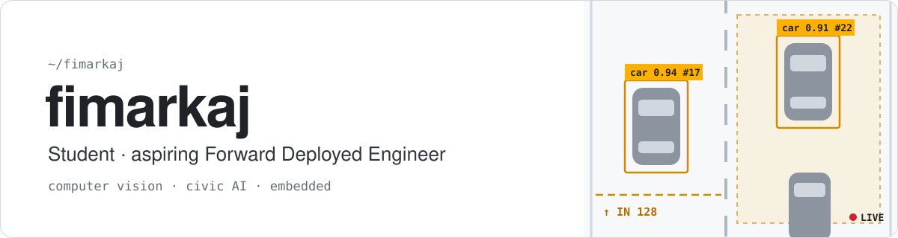

<picture>
  <source media="(prefers-color-scheme: dark)" srcset="./assets/banner-dark.svg">
  <source media="(prefers-color-scheme: light)" srcset="./assets/banner-light.svg">
  
</picture>

  
  

I'm a student working toward becoming a **Forward Deployed Engineer**: the person who takes a model out of the notebook and makes it work inside a real organisation, with its messy data and real constraints.

So far that has meant running computer vision on live traffic camera streams and putting language models behind a civic reporting platform for the Municipality of Gjakova. I led the team on both.

<!-- Add one line here once you've decided what the profile is for, e.g.
     "Currently looking for FDE / AI engineering internships for summer 2027." -->

### Highlights

- 🏆 **Won the Aithon** in Gjakova, part of the AI4Society hackathon
- 🧭 **Team lead** on both projects below
- 🗣️ **English and German**, both fluent

---

### 🚦 [Smart Traffic Gjakova](https://github.com/fimarkaj/Smart_Traffic_Gjakova)

Real-time traffic monitoring from a live camera stream.

- Detects and tracks vehicles with **YOLOv11 + ByteTrack** on HLS / RTSP streams
- Custom polygon zones for lane occupancy, plus directional line-crossing counters
- When congestion spikes, saves a clip from 30 s before to 30 s after and sends alerts by webhook, Telegram or email
- ML congestion forecasting, with export to **SUMO** for traffic simulation

Python · FastAPI · React 18 · Vite · SQLite · Docker — MIT licensed

### 🏛️ [Gjakova Connect](https://github.com/fimarkaj/Gjakova_Connect)

A civic reporting platform for the Municipality of Gjakova, with an Albanian interface.

- Anonymous reports, each tracked by a ticket code (`GJK-1001`)
- AI routes every report to one of **13 municipal departments** with an urgency level, screens it for quality, and rewrites messy Albanian text into a clear report; a vision model reads attached photos
- Catches duplicates by location and content, and flags **chronic issues** (3+ reports within 100 m)
- A **"silence map"** compares report counts with 2024 census population, to show where people may be under-reporting
- Drafts emails to departments and to citizens

Next.js 14 · TypeScript · Supabase (Postgres) · OpenAI API · Leaflet · Nodemailer

---

### Toolbox

  

Python · PyTorch · JavaScript / TypeScript · SQL · Docker · Kubernetes · Arduino

---

  If you're putting AI to work in the real world, I'd like to hear about it: <a href="mailto:fimarkaj@gmail.com">fimarkaj@gmail.com</a>

